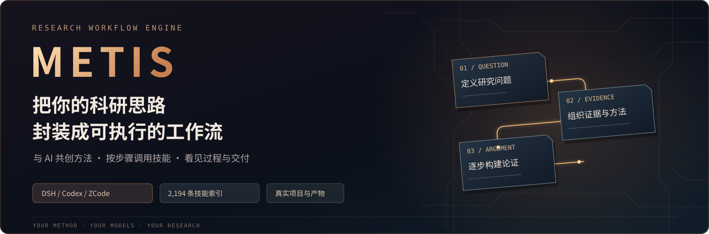
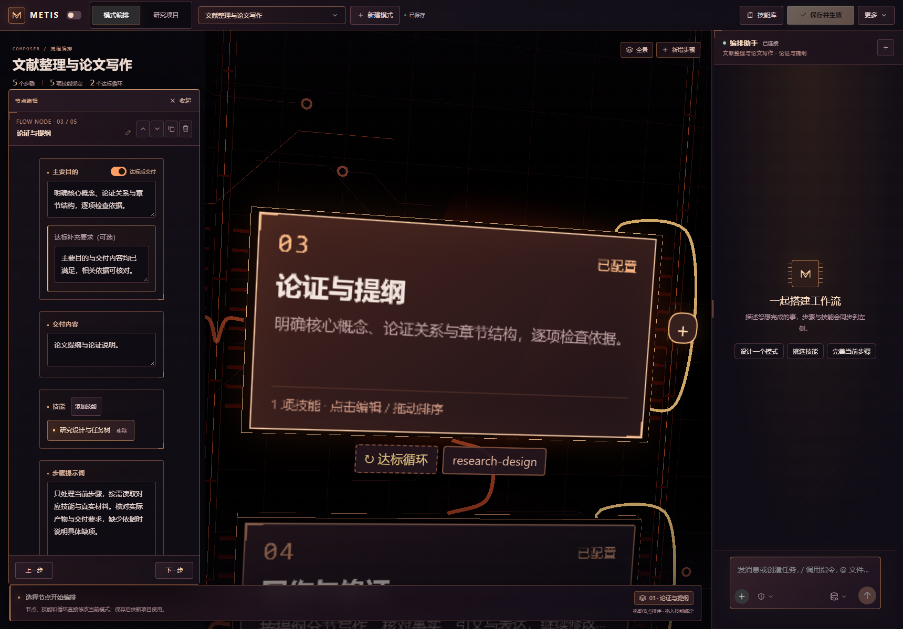
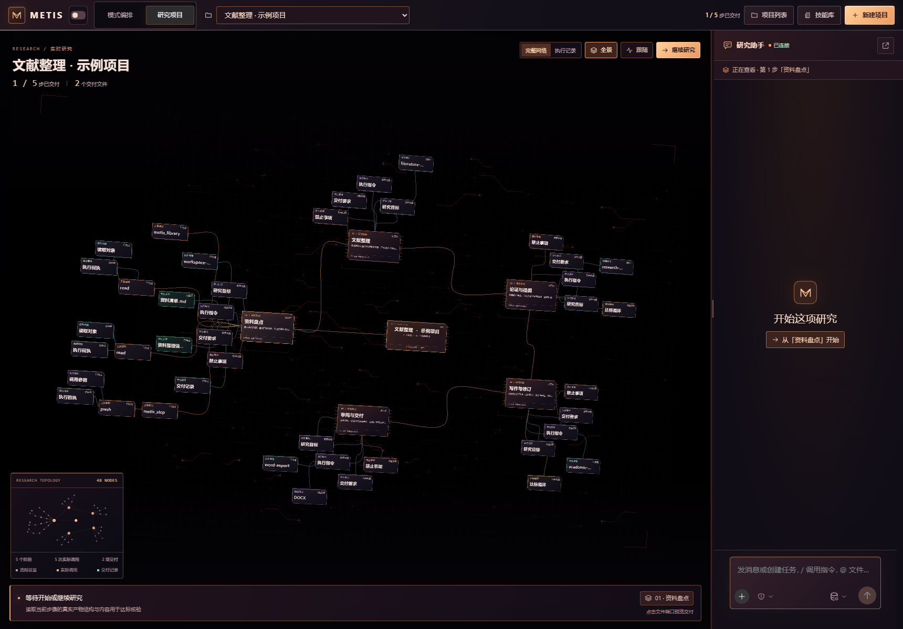
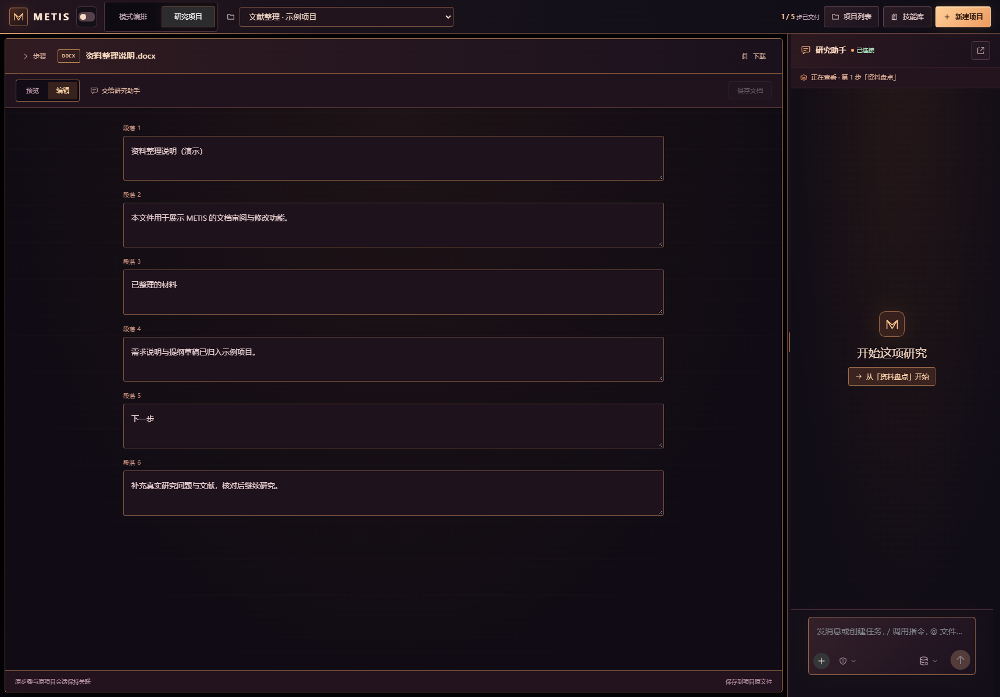

<p align="center">
  
</p>

<p align="center">
  <a href="https://github.com/TZUKWAN/METIS_ACADEMIC/releases/latest"></a>
  <a href="LICENSE"></a>
  
</p>

<p align="center"><strong>一起搭流程 · 看见研究进展 · 按步骤改成果</strong></p>

METIS 是 DeepSeek Harness 里的 AI 科研工作台。把研究想法聊清楚，和 AI 一起搭建流程；研究开始后，在同一个界面查看它正在做什么、检查每一步的产物，并继续提出修改意见。

适合需要反复整理资料、构建论证、写作和修订的人文社会科学项目，也支持编排自己的其他研究流程。

## 从想法到一套自己的流程

直接和右侧 AI 助手讨论目标，让它帮助设计步骤、挑选技能和完善要求。需要微调时，也可以自己改：

- **步骤名称与主要目的**：明确这一阶段做什么。
- **交付内容**：约定留下哪些文件、清单或其他成果。
- **技能与提示词**：给不同步骤安排合适的做法。
- **禁止事项**：可选，写下这一步不允许 AI 做什么。
- **达标循环**：未达到目标时继续改进，再交付。

步骤能新增、删除、复制、拖动排序。AI 和界面共同编辑同一份流程，手动修改保留优先，最后点击一次 **保存并生效**。



## 研究过程，看得见也点得动

研究项目是一张可以缩放、平移的离子回路网络。主阶段是骨架，目标、技能、工具调用、读取对象、核验和交付文件逐渐展开。

执行中的线路会点亮；完成、失败、等待处理各有自己的状态。点一个节点，就能查看具体记录；也能用缩略图快速定位，切换完整网络或执行记录。

右侧保留 **DSH 原生研究助手**，继续使用 DSH 已配置的模型、工具、流式消息和会话历史。



## 哪一步不满意，就改哪一步

点开一个阶段，研究助手会知道你正在看哪一步。直接说哪里不满意、希望怎样改，不必每次重述步骤编号。

本步修改并交付后，再选择后续结果是保留还是重做。已有交付可以回看，研究过程不必每次从头开始。

## 把科研技能组合成自己的工具箱

内置 **2000+ 条具体技能的来源目录**，支持搜索、查看来源、阅读说明，并把选中的技能放进步骤。

技能正文和资源按需从原作者的固定版本读取。运行到哪一步，再加载该步需要的内容；需要脚本时准备对应资源，不把整座技能库一次塞进对话。也可以通过配置助手创建、安装和修改技能。

首次读取第三方技能需要联网；相关工具、账号与依赖按各技能的实际要求准备。技能保留各自许可。

## 成果在项目里审阅，意见直接交给助手

点击文件节点，在工作台内打开成果：

| 文件 | 可以做什么 |
|---|---|
| Word / PPT | 预览并修改文字内容，保存后继续核对。 |
| Excel | 查看工作表、修改单元格。 |
| Markdown / TXT | 直接查看和编辑。 |
| PDF | 预览内容，把修改意见交给研究助手。 |

最终步骤可选择 Word、PPT、PDF 或 Markdown 等交付格式。Word 的排版要求可以用自然语言写，例如“正文宋体小四、1.5 倍行距，一级标题黑体”。



<sub>以上为示例项目与演示文档，用于展示界面和操作。</sub>

## 新流程继续改，旧项目保留原样

项目创建时会固定所选模式的配置。以后修改模式、技能或提示词，供新项目使用；已有项目继续沿用自己的流程版本，重启后也能恢复。

## 安装与开始

建议使用 **DSH 0.2.2 系列或更新的兼容 0.2.x 版本**。

1. 在 DSH 插件管理中使用下面的预构建安装包来源，按宿主提示确认安装。

   ```text
   https://github.com/TZUKWAN/METIS_ACADEMIC/releases/latest/download/metis-academic-preset.tgz
   ```

2. 按 DSH 提示完成加载，打开侧边栏 **METIS**。
3. 新建模式，和 AI 讨论或手动编辑步骤，**保存并生效**。
4. 新建研究项目，选择模式与资料目录，在研究助手中说明这次任务。

<details>
<summary>在 DSH「发现」页搜索 METIS</summary>

启用 DSH 的“自定义插件索引”，在“发现 → 添加索引源”中添加：

```text
https://raw.githubusercontent.com/TZUKWAN/METIS_ACADEMIC/main/marketplace/index.json
```

随后可在该索引里搜索 **METIS**。公共社区目录的收录状态以提交记录和市场实际更新为准。

</details>

<details>
<summary>网页版命令行安装</summary>

```sh
dsh plugin --profile web add https://github.com/TZUKWAN/METIS_ACADEMIC/releases/latest/download/metis-academic-preset.tgz
```

桌面版请使用应用自己的插件管理；`web` profile 和桌面应用的 profile 不相同。

</details>

## 使用前了解

- 使用你自己的 DSH 模型配置，模型服务产生的费用由对应服务计收。
- 三维网络需要 WebGL2；文档功能需要 DSH 可用的文档服务及相应依赖。首次使用具体技能或文档功能时，可能需要准备 Python 3.10+、相关工具或账号。
- METIS 帮助组织和执行研究，引用、事实、数据与最终稿仍需核对。技能入库不等于它的全部环境和科研效果已经验证。
- 工作流、项目和会话数据保存在使用者自己的环境中。本仓库不包含作者的账号配置、会话或研究资料。

## 开源与参与

欢迎反馈使用问题、改进流程设计和贡献兼容修正。请在 [Issues](https://github.com/TZUKWAN/METIS_ACADEMIC/issues) 描述你使用的 DSH 版本、操作与实际结果，提交日志前移除密钥和私人资料。

METIS 自 1.6.2 起的原创代码发行采用 [Apache License 2.0](LICENSE)，允许商用、修改和分发，需遵守其版权、许可及声明保留等条件。旧版 MIT 授权不追溯变更，见 [许可历史](LICENSE_HISTORY.md)。第三方组件和技能各自保留原许可，见 [第三方说明](THIRD_PARTY_NOTICES.md)。构建和贡献方式见 [开发说明](CONTRIBUTING.md)。
