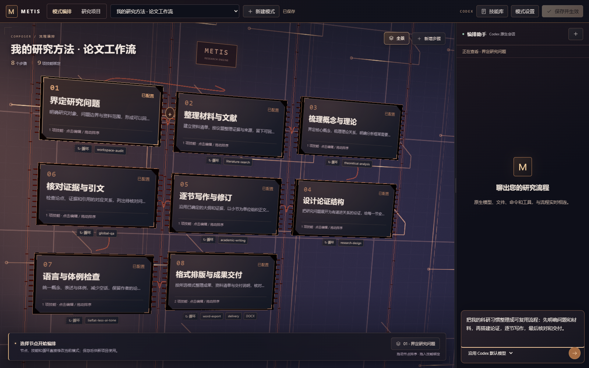
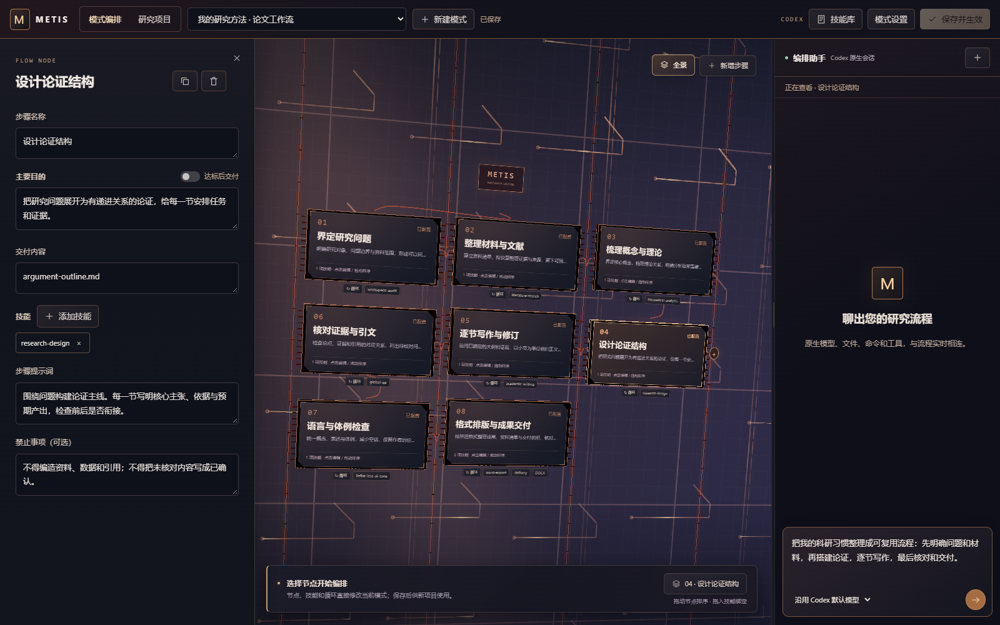
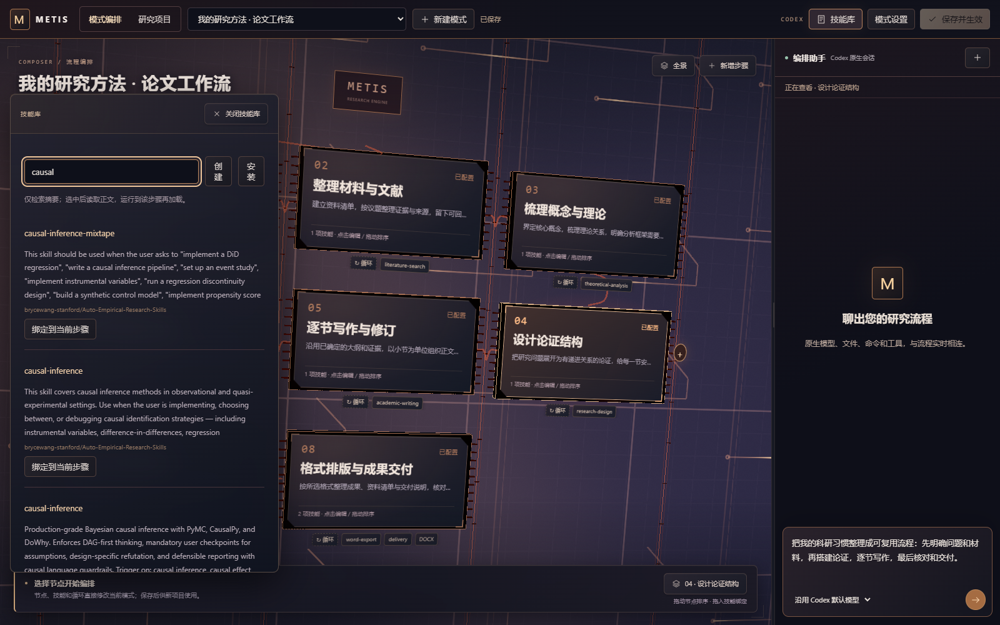
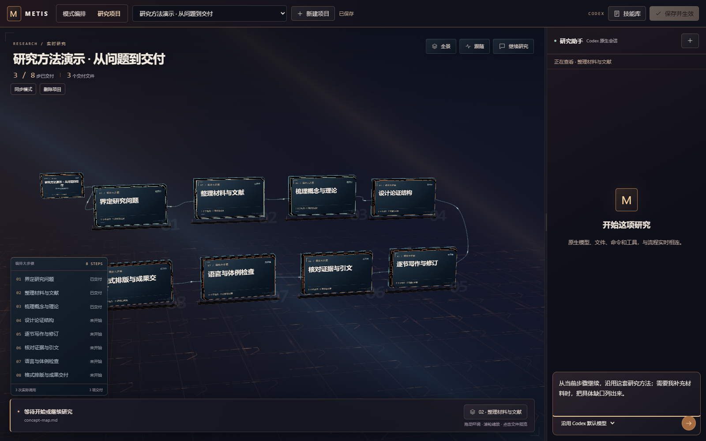
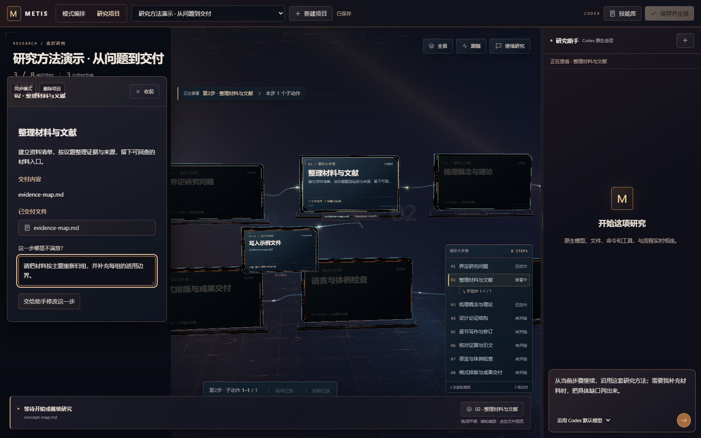
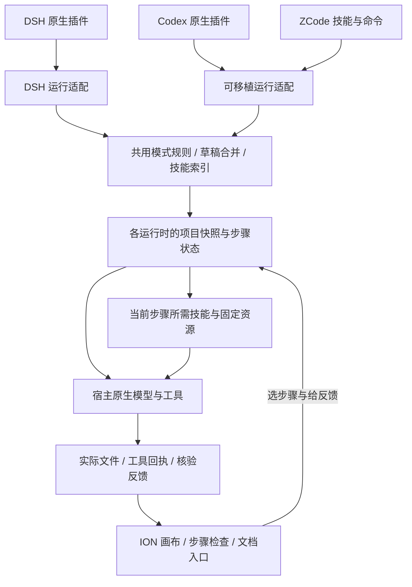

<p align="center">
  
</p>

<p align="center">
  <a href="https://github.com/TZUKWAN/METIS_ACADEMIC/releases/latest"></a>
  <a href="LICENSE"></a>
  <a href="docs/install/dsh.md"></a>
  <a href="docs/install/codex.md"></a>
  <a href="docs/install/zcode.md"></a>
</p>

<p align="center">
  <a href="#把科研思路封装成自己的工作流">工作流共创</a> ·
  <a href="#科研技能库">科研技能库</a> ·
  <a href="#可视化研究现场">研究现场</a> ·
  <a href="#技术架构">技术架构</a> ·
  <a href="#安装与开始">安装 METIS</a>
</p>

**METIS 是一个可以和 AI 一起搭建、执行和修订科研流程的工作台。**

你决定研究要怎样推进：先读什么材料、用什么方法、每一步留下什么成果、哪些事不能做。METIS 把这些想法保存为可复用的模式，再把具体技能、原生工具、执行记录和交付文件连到每一步上。

适合把自己的论文写作、文献整理、理论分析、研究方案、资料分析或报告制作方法逐步沉淀下来的人。支持 **DeepSeek Harness、Codex 和 ZCode**。

| 你想做的事 | METIS 提供的操作 |
|---|---|
| 把自己的科研思路整理成方法 | 与 AI 聊目标、拆步骤，保存为自己的研究模式。 |
| 给每一步安排合适的做法 | 搜索具体技能，绑定到步骤，写清目的、产物和执行要求。 |
| 知道研究推进到了哪里 | 在离子回路里查看主阶段、子动作、实际文件和工具回执。 |
| 对某一步提出修改意见 | 点选该步讨论，修订交付后决定后续成果保留还是重做。 |
| 把好用的方法用于新课题 | 新建项目时选择已保存模式，再绑定本次资料目录。 |
| 继续改进方法，同时保留旧任务 | 项目保存自己的流程与技能快照，需要时再明确同步新版。 |

## 把科研思路封装成自己的工作流

**把一次有效的研究做法，变成下一次可以直接使用的流程。**

可以先和助手这样聊：

> 我习惯先确认问题和材料，再梳理概念、搭建论证，之后逐节写作、核对证据，最后处理格式。帮我把这套做法封装成一个模式，并给每一步安排需要的技能。

AI 和你共同编辑同一份草稿。你可以随时查看它拆出的步骤，也可以直接修改名称、目的、交付内容、技能和提示词。并发编辑会保护手动修改，避免过期 AI 回复覆盖新内容；最后点击一次 **保存并生效**。



*截图为 v1.7 跨宿主本机工作台的独立演示模式。右侧输入是尚未发送的需求草稿。*

例如，一套论文工作流可以这样组织；步骤可按自己的研究方法增删、复制和拖动排序：


每一步保留清楚的编辑入口：

- **主要目的**：这一步要完成什么。
- **交付内容**：留下哪些文件、清单、图表或其他成果。
- **技能与步骤提示词**：给本步安排具体方法与执行要求。
- **禁止事项**：可选，写下这一步不允许 AI 做的事。
- **达标后交付**：可开启目标核验与反馈改进，让目的参与交付判断。

<details>
<summary><strong>展开看：一个步骤怎样编辑</strong></summary>



模式也支持新建、改名、编辑说明和删除。你可以为不同研究习惯保存不同模式，再在项目创建时选择。

</details>

## 科研技能库

v1.7 的科研技能目录包含 **2,194 条条目**，覆盖文献检索、研究设计、实证分析、因果推断、可视化、学术写作、修订和交付等方向。

你可以按关键词搜索，也可以请助手围绕本步目的查找、阅读和绑定合适的具体技能。

**查找具体技能 → 阅读说明与来源 → 绑定步骤 → 执行到该步时加载所需内容。**

技能正文分段读取，脚本和资源按需准备。这样，整座技能库可以成为可选工具箱，而初始化对话只需要当前任务相关的内容。助手还能创建、安装和修改技能，逐步积累你自己的做法。



<details>
<summary><strong>查看部分技能来源与当前目录数量</strong></summary>

| 来源项目 | 当前已索引条目 | 方向 |
|---|---:|---|
| [Auto-Empirical-Research-Skills](https://github.com/brycewang-stanford/Auto-Empirical-Research-Skills) | 1,270 | 实证研究、研究方法与分析工具 |
| [research-plugins](https://github.com/wentorai/research-plugins) | 473 | 文献、研究方法、分析与写作 |
| [scientific-agent-skills](https://github.com/K-Dense-AI/scientific-agent-skills) | 177 | 科研分析与科学计算 |
| [AI-Research-SKILLs](https://github.com/Orchestra-Research/AI-Research-SKILLs) | 98 | AI 研究与实验工具链 |
| [AcademicForge](https://github.com/HughYau/AcademicForge) | 33 | 科研工具与技能组合 |
| [research-writing-skill](https://github.com/Norman-bury/research-writing-skill) | 20 | 长期写作项目与流程管理 |
| [cnki-skills](https://github.com/cookjohn/cnki-skills) | 10 | 中文文献与知网工作流 |

目录也收录了 academic-humanizer、humanities-thesis-skill、social-science-paper-writing-skill、paper-search-mcp 等项目的具体入口，并解析部分聚合项目的下游来源。来源与许可说明见 [技能库说明](dsh-plugin/metis-preset/library/NOTICE.md)。

上表是来源目录的索引数量。实际绑定遵循各条目的调用策略；技能正文和资源从原作者固定版本按需读取，工具、账号和依赖按技能要求准备。各技能保留自己的许可。

</details>

## 可视化研究现场

创建研究项目时，选一个已保存模式，再绑定本次资料文件夹。一个文件夹可以对应多个项目，每个项目分别记录自己的步骤与进度。

**主阶段构成研究骨架，子动作在所属阶段下展开。**

离子回路把这些记录放进可缩放、可环绕的三维空间：全景看整体，跟随定位当前工作，点开阶段查看它的目标、技能、实际调用和交付文件。执行、完成、失败和等待各有相应状态，线路与节点的动效跟随记录变化。



*演示项目通过实际插件接口建立，前三步已生成并提交示例文件，后续步骤待执行。示例内容用于展示操作。*

你可以沿着一个问题，查看它经过了哪些步骤、调用过什么工具，以及最后落到了哪个文件上。工具公开输出可汇入现场；模型可见信息沿用对应宿主的呈现规则。

## 围绕具体步骤持续修订

点选一个步骤，助手会获得当前查看步骤的上下文。直接写“把这一组材料按主题重新整理”“这段论证还不够清楚”或“补充这里的证据”，可以围绕该步继续工作。

修订交付后，再选择 **保留后续成果** 或 **重做后续步骤**，把返修范围控制在本次需要处理的地方。



流程可以继续迭代，项目则保留自己的流程与技能版本。需要采用新版模式时，在项目空闲时明确同步，保留旧快照与交付记录。删除项目保留资料目录和交付文件。

## 成果交付与文档审阅

最终步骤可设置 Word、PPT、PDF、Markdown 等输出要求。Word 的排版规定可以直接用自然语言写：

> 正文宋体小四，1.5 倍行距，首行缩进两个字符；标题层级清楚，脚注与参考文献格式统一。

排版要求随当前步骤交给技能和宿主工具处理。交付时核对实际文件；开启达标循环的步骤会结合目标、交付要求和核验反馈继续改进。

**DSH 版**可在文档工作区预览 Word/PPT 并修改文字、查看 Excel 并编辑单元格、编辑 Markdown/TXT、预览 PDF。**Codex/ZCode 版**直接编辑 MD/TXT/CSV/JSON、预览 PDF，Office 高级编辑通过宿主工具或本机文档软件完成。

<details>
<summary><strong>展开看：DSH 文档审阅示例</strong></summary>


此图为 DSH 示例文档界面；上方流程、技能与研究现场图来自 v1.7 跨宿主本机工作台。

</details>

## 技术架构

METIS 保留宿主的模型、工具和审批方式。DSH 接入原生服务；Codex 使用原生 app-server 会话；ZCode 通过原生技能、命令和 MCP 与工作流交互。

两种运行适配共用编排规则、技能目录和 ION 可视化组件，各自管理运行中的项目、会话和快照。前端使用 React 与 Three.js；可移植服务使用 Node.js 与 MCP，科研和文档脚本按技能需求调用。图形视图由实际步骤状态、工具回执和文件记录驱动。



| 层次 | 解决的问题 | 主要位置 |
|---|---|---|
| 宿主接入 | 连接原生会话、工具、流式事件与权限处理 | `dsh-plugin/` · `portable/runtime/` |
| 编排与项目 | 模式、草稿合并、快照、步骤状态、返修范围与交付检查 | [dsh-plugin/metis-preset](dsh-plugin/metis-preset) · [portable/runtime/core.mjs](portable/runtime/core.mjs) |
| 技能资源 | 检索目录、固定版本、分段读取和按需资源 | [技能目录](dsh-plugin/metis-preset/library) · [skill-library.js](dsh-plugin/metis-preset/skill-library.js) |
| 可视化与交互 | 主阶段、子动作、空间连线、选中上下文与编辑入口 | [dsh-plugin/metis-mode/client](dsh-plugin/metis-mode/client) · [portable/ui](portable/ui) |

在同机、同一数据目录下，可以共用已保存的模式和技能配置；DSH 与可移植版分别保存自己的编排草稿和研究项目。构建与贡献方式见 [开发说明](CONTRIBUTING.md)。

## 安装与开始

**复制对应宿主的提示词，让智能体完成下载安装、版本核对与只读检查。**

<p align="center">
  <a href="docs/install/dsh.md"><strong>DSH 安装提示词</strong></a>　｜　
  <a href="docs/install/codex.md"><strong>Codex 安装提示词</strong></a>　｜　
  <a href="docs/install/zcode.md"><strong>ZCode 安装提示词</strong></a>　｜　
  <a href="docs/INSTALL_PROMPTS.md">三段合集</a>
</p>

| 宿主 | 对话与工作台 | 安装 |
|---|---|---|
| **DSH** | 原生 METIS 页面、研究助手与文档服务 | [DSH 专用流程](docs/install/dsh.md) |
| **Codex** | 原生插件和完整工具会话；工作台按宿主能力内嵌或本机打开 | [Codex 专用流程](docs/install/codex.md) |
| **ZCode** | 原生技能、命令和 MCP，沿用 ZCode 主对话 | [ZCode 专用流程](docs/install/zcode.md) |

也可以从 [最新 Release](https://github.com/TZUKWAN/METIS_ACADEMIC/releases/latest) 下载：

- `metis-academic-preset.tgz`：DSH 安装包。
- `METIS-Codex-ZCode.zip`：Codex/ZCode 原生插件包。
- `SHA256SUMS`：下载文件校验值。

<details>
<summary><strong>DSH 自定义插件索引</strong></summary>

在 DSH 的“发现 → 添加索引源”中使用：

```text
https://raw.githubusercontent.com/TZUKWAN/METIS_ACADEMIC/main/marketplace/index.json
```

桌面版由应用自己的插件管理器安装；Web profile 使用自己的安装入口。具体版本和工具要求见上方专用安装文档。

</details>

### 使用条件

使用兼容宿主、可用模型与相应工具权限。三维视图需要 WebGL2；首次使用第三方技能、科研脚本或文档功能时，按实际要求准备网络、Python、相关依赖及账号。Codex/ZCode 的独立达标核验使用本机已登录的 Codex。

配置、项目记录和会话快照保存在使用者环境中，模型连接与费用沿用宿主配置。引用、事实、数据和最终稿按研究规范核对。各宿主的已验证范围见 [发布核对](docs/releases/verification-1.7.0.md)。

## 开源与参与

欢迎在 [Issues](https://github.com/TZUKWAN/METIS_ACADEMIC/issues) 交流使用问题、研究工作流和兼容改进，也欢迎贡献具体技能与流程设计经验。提交日志和示例前移除私人资料及密钥。

METIS 自 1.6.2 起的原创代码采用 [Apache License 2.0](LICENSE)，支持按许可要求使用、修改与分发。第三方组件和科研技能保留各自许可，见 [第三方说明](THIRD_PARTY_NOTICES.md) 与 [许可历史](LICENSE_HISTORY.md)。
